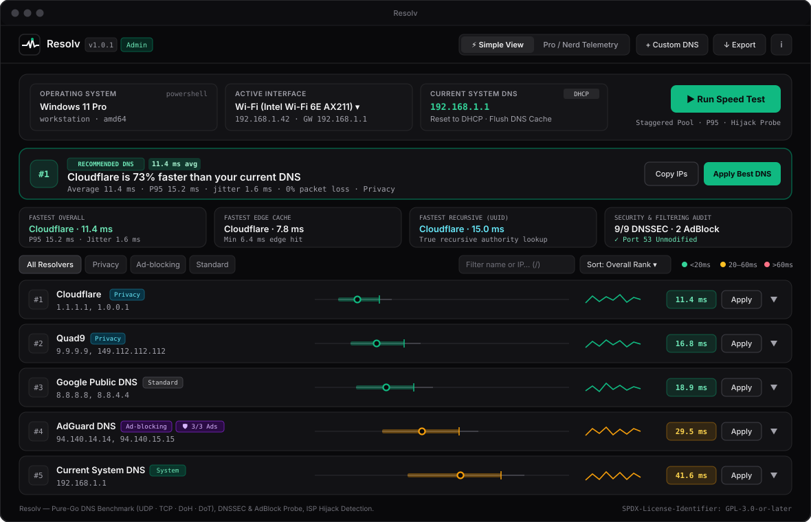
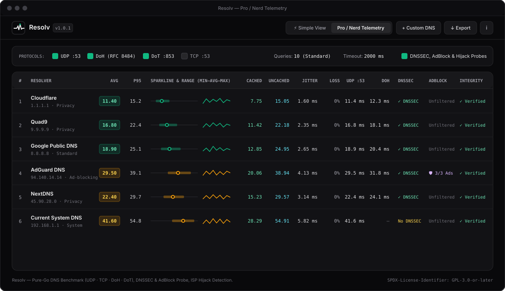

<div align="center">
  

  # Resolv

  **Cross-Platform DNS Protocol Benchmarker, Privacy Probe & One-Click Switcher**

  [](https://github.com/efeartn/Resolv/actions/workflows/release.yml)
  [](https://github.com/efeartn/Resolv/releases/latest)
  [](./LICENSE)
  [](./go.mod)
  [](https://wails.io)
  [](#download-pre-built-binaries)

  <p align="center">
    <a href="#download-pre-built-binaries"><strong>Download Binaries</strong></a> ·
    <a href="#interface-preview"><strong>Screenshots</strong></a> ·
    <a href="#key-capabilities"><strong>Capabilities</strong></a> ·
    <a href="#curated-resolvers"><strong>Resolvers</strong></a> ·
    <a href="#building-from-source"><strong>Build from Source</strong></a>
  </p>
</div>

---

## Overview

**Resolv** is a native, standalone cross-platform desktop utility for **Windows**, **macOS**, and **Linux** built with **Go**, [`github.com/miekg/dns`](https://github.com/miekg/dns), and **Wails v2** (OS-native webviews: WebView2 on Windows, WKWebView on macOS, WebKitGTK on Linux).

Unlike generic network tools that rely on `ICMP ping` (which measures ICMP echo response rather than actual DNS resolution performance and is frequently rate-limited or deprioritized by anycast routers), **Resolv** speaks the DNS wire protocol directly over **UDP (`:53`)**, **TCP (`:53`)**, **DoH (RFC 8484)**, and **DoT (`:853`)**.

---

## Interface Preview

### 1. Simple View — Everyday One-Click Speed Test & Switching
Designed for zero-friction operation: auto-detects your active network adapter and current DNS, benchmarks every resolver with inline SVG **[Min — ●Avg — |P95 — Max]** range bars and real-time sparklines, and highlights the #1 recommended provider with a plain-English summary and one-click **Apply Best DNS**.

<p align="center">
  
</p>

### 2. Pro / Nerd Telemetry View — Protocol Matrix & Security Probes
Designed for network engineers and privacy enthusiasts: inspect **Average**, **P95 (95th percentile)**, **Cached vs. Uncached (UUID recursive)** latency, **Jitter ($\sigma$)**, **Packet Loss (%)**, side-by-side **UDP `:53` vs. DoH** performance, **DNSSEC validation**, **Ad/Tracker sinkhole probing**, and **ISP DNS Hijacking detection**.

<p align="center">
  
</p>

---

## Download Pre-Built Binaries

Standalone binaries are automatically compiled and published by GitHub Actions on every release tag:

| Operating System | Architecture | Package / Binary | Native Webview Engine |
| :--- | :--- | :--- | :--- |
| **Windows 10 / 11** | `x86_64 (amd64)` | [`resolv-windows-amd64.exe`](https://github.com/efeartn/Resolv/releases/latest/download/resolv-windows-amd64.exe) | Microsoft Edge WebView2 |
| **macOS 12+** | `Universal (Intel + Apple Silicon)` | [`resolv-macos-universal.zip`](https://github.com/efeartn/Resolv/releases/latest/download/resolv-macos-universal.zip) | Apple `WKWebView` |
| **Linux** | `x86_64 (amd64)` | [`resolv-linux-amd64`](https://github.com/efeartn/Resolv/releases/latest/download/resolv-linux-amd64) | `WebKitGTK 4.1` |
| **Checksums** | `SHA-256` | [`SHA256SUMS.txt`](https://github.com/efeartn/Resolv/releases/latest/download/SHA256SUMS.txt) | — |

---

## Key Capabilities

### ⚡ 1. Anti-Bufferbloat Multi-Protocol DNS Engine (`internal/dns/`)
- **Multi-Protocol Wire Support:** Benchmarks **UDP (`:53`)**, **TCP (`:53`, RFC 7766 connection reuse)**, **DoH (RFC 8484 `application/dns-message` over HTTP/2)**, and **DoT (`:853` TLS 1.2/1.3)**.
- **Session Warm-Up & Staggered Worker Pool:** Establishes TCP/TLS/HTTP2 handshakes in an untimed warm-up phase so connection setup never skews query RTT. Dispatches interleaved queries round-robin across servers with a `12 ms` stagger across a bounded worker pool (`12` workers) to eliminate local socket exhaustion and router bufferbloat.
- **Cached vs. Uncached Resolution:**
  - **Cached Queries:** Queries high-traffic domains (`cloudflare.com`, `google.com`, `apple.com`) to measure edge-cache hit latency.
  - **Uncached Queries:** Generates a unique UUID v4 subdomain per query (`<random-uuid>.example.com`) to bypass caches and measure true recursive upstream resolution.
- **Comprehensive Metrics:** Computes **Average (`ms`)**, **Min (`ms`)**, **Max (`ms`)**, **Median (`ms`)**, **P95 (`ms`)**, **Jitter ($\sigma$ standard deviation `ms`)**, **Packet Loss (`%`)**, and retains chronological RTT samples for inline SVG sparklines.

### 🛡️ 2. Cybersecurity, Privacy & Censorship Probes (`internal/dns/integrity.go`)
- **DNSSEC Validation Probe:** Verifies whether each resolver sets the `AD` (Authenticated Data) flag on signed zones (`cloudflare.com`) and properly returns `SERVFAIL` (`RcodeServerFailure`) when querying a domain with a deliberately broken DNSSEC signature (`dnssec-failed.org`).
- **Ad & Tracker Sinkhole Probe:** Queries known ad-serving and telemetry canary domains (`doubleclick.net`, `pagead2.googlesyndication.com`, `app-measurement.com`) and flags resolvers that actively block them via sinkhole IPs (`0.0.0.0`, `127.0.0.1`, `::`), `NXDOMAIN`, `REFUSED`, or `NODATA`.
- **ISP DNS Hijacking & Transparent Proxy Detection:**
  1. **RFC 5737 Canary Probe:** Sends a UDP `:53` query to an unroutable `TEST-NET-1` address (`192.0.2.53:53`). Any response proves that an ISP or router firewall is transparently intercepting port 53 traffic.
  2. **NXDOMAIN Tampering Check:** Compares plain UDP `:53` responses against encrypted DoH responses for non-existent random domains to detect ISP search-redirect injection.
  3. **Bogon/Private IP Redirection Check:** Detects captive portals or block-page redirections where plain DNS returns private RFC 1918 / CGNAT addresses while DoH returns public IPs.
  4. **Egress Identity Fingerprinting:** Queries `whoami.akamai.net` over both UDP `:53` and DoH to detect cross-provider transparent proxying.

### 💻 3. Native Cross-Platform OS Network Abstraction (`internal/sysnet/`)
| Platform | Active Interface Detection | Apply / Reset DNS | Flush DNS Cache | Privilege Elevation |
| :--- | :--- | :--- | :--- | :--- |
| **Windows** (`net_windows.go`) | PowerShell `Get-NetAdapter`, `Get-NetRoute`, `Get-DnsClientServerAddress` | `Set-DnsClientServerAddress` / `-ResetServerAddresses` | `ipconfig /flushdns` & `Clear-DnsClientCache` | UAC (`Start-Process -Verb RunAs`) |
| **macOS** (`net_darwin.go`) | `networksetup -listnetworkserviceorder`, `route -n get default`, `scutil --dns` | `networksetup -setdnsservers <svc> <ips>` / `Empty` | `dscacheutil -flushcache; killall -HUP mDNSResponder` | Native macOS Admin dialog (`osascript`) |
| **Linux** (`net_linux.go`) | `/proc/net/route`, `ip route`, `nmcli`, `resolvectl` | `nmcli connection modify` (fallback to `resolvectl dns`) | `resolvectl flush-caches` | Polkit (`pkexec`) |

- **Strict IP Validation Boundary:** Every DNS address passed to an OS mutation command is validated via `net.ParseIP` prior to command construction.
- **Graceful Non-Admin Fallback:** If the user cancels the elevation prompt or runs without root/admin rights, **Resolv** opens a **"Copy DNS Addresses & Terminal Command"** modal with one-click clipboard copy and OS-specific step-by-step instructions.

---

## Curated Resolvers

In addition to auto-detecting your **Current System DNS** and **Local Router / Gateway**, **Resolv** ships with the following built-in resolvers (plus support for persistent custom IPv4, IPv6, DoH, and DoT resolvers):

| Provider | Category | Primary IPv4 | Secondary IPv4 | DoH Endpoint (RFC 8484) | DoT Host (`:853`) |
| :--- | :--- | :--- | :--- | :--- | :--- |
| **Cloudflare** | `Privacy` | `1.1.1.1` | `1.0.0.1` | `https://cloudflare-dns.com/dns-query` | `one.one.one.one` |
| **Google Public DNS** | `Standard` | `8.8.8.8` | `8.8.4.4` | `https://dns.google/dns-query` | `dns.google` |
| **Quad9** | `Privacy` | `9.9.9.9` | `149.112.112.112` | `https://dns.quad9.net/dns-query` | `dns.quad9.net` |
| **AdGuard DNS** | `Ad-blocking` | `94.140.14.14` | `94.140.15.15` | `https://dns.adguard-dns.com/dns-query` | `dns.adguard-dns.com` |
| **NextDNS** | `Privacy` | `45.90.28.0` | `45.90.30.0` | `https://dns.nextdns.io` | `dns.nextdns.io` |
| **OpenDNS** | `Standard` | `208.67.222.222` | `208.67.220.220` | `https://doh.opendns.com/dns-query` | `dns.opendns.com` |
| **Control D** | `Standard` | `76.76.2.0` | `76.76.10.0` | `https://freedns.controld.com/p0` | `p0.freedns.controld.com` |
| **CleanBrowsing Family** | `Family` | `185.228.168.168` | `185.228.169.168` | `https://doh.cleanbrowsing.org/doh/family-filter/` | `family-filter-dns.cleanbrowsing.org` |

---

## Keyboard Shortcuts

| Shortcut | Action |
| :--- | :--- |
| `/` or `Ctrl+K` (`⌘K`) | Focus quick resolver search / filter bar |
| `Alt+1` | Switch to **Simple View** |
| `Alt+2` | Switch to **Pro / Nerd Telemetry View** |
| `Escape` | Close active modal or clear search filter |

---

## Project Architecture

```text
Resolv/
├── LICENSE                         # GNU General Public License v3.0
├── go.mod / go.sum                 # Go module configuration
├── wails.json                      # Wails v2 project & packaging configuration
├── main.go                         # Native desktop window & embedded assets
├── app.go                          # Wails bound controller & custom resolver persistence
├── .github/workflows/release.yml   # Automated multi-OS GitHub Actions release pipeline
├── build/
│   ├── appicon.svg                 # Pure flat geometric vector icon (zero gradients/filters)
│   └── appicon.png                 # 512×512 PNG application icon
├── docs/screenshots/               # UI screenshots for Simple & Pro views
├── frontend/
│   ├── index.html                  # Progressive disclosure Simple & Pro UI
│   ├── styles.css                  # Minimalist zinc/slate dark theme & latency badges
│   ├── app.js                      # State manager, pure SVG range-bars & sparklines
│   └── icon.svg                    # Header & modal vector icon
└── internal/
    ├── dns/
    │   ├── resolvers.go            # Built-in resolvers + system/gateway/custom parser
    │   ├── transport.go            # UDP :53, TCP :53, DoH (RFC 8484), DoT :853 queriers
    │   ├── stats.go                # Avg, Min, Max, Median, P95, Jitter (σ), Loss, Samples
    │   ├── engine.go               # Warm-up + staggered worker pool benchmark coordinator
    │   ├── integrity.go            # DNSSEC, AdBlock sinkhole, and ISP Hijack probes
    │   ├── export.go               # JSON, CSV, and Markdown report exporters
    │   └── engine_test.go          # Automated unit & integration tests
    └── sysnet/
        ├── sysnet.go               # Cross-platform types & strict IP validation boundary
        ├── exec_windows.go         # Hidden subprocess creation flags on Windows
        ├── exec_unix.go            # POSIX locale normalization & /etc/resolv.conf reader
        ├── net_windows.go          # Windows PowerShell/CIM + UAC implementation
        ├── net_darwin.go           # macOS networksetup/scutil + osascript implementation
        └── net_linux.go            # Linux nmcli/resolvectl + pkexec implementation
```

---

## Building from Source

### Prerequisites
- **Go 1.26+**
- **Wails v2 CLI:**
  ```bash
  go install github.com/wailsapp/wails/v2/cmd/wails@v2.17.1
  ```
- **Platform WebView Dependencies:**
  - **Windows:** WebView2 Runtime (pre-installed on Windows 10/11)
  - **macOS:** Xcode Command Line Tools (`xcode-select --install`)
  - **Linux (Debian/Ubuntu):** `sudo apt install build-essential pkg-config libgtk-3-dev libwebkit2gtk-4.1-dev`

### Run Unit Tests
```bash
go test -v ./internal/...
```

### Cross-Platform Production Builds
```bash
# Windows (standalone .exe -> build/bin/resolv.exe)
wails build -platform windows/amd64 -clean -trimpath -ldflags "-s -w"

# macOS (Universal .app bundle for Intel + Apple Silicon -> build/bin/Resolv.app)
wails build -platform darwin/universal -clean -trimpath -ldflags "-s -w"

# Linux (x86_64 standalone binary -> build/bin/resolv)
wails build -platform linux/amd64 -tags webkit2_41 -clean -trimpath -ldflags "-s -w"
```

---

## License

Copyright (C) 2026 Resolv Contributors.  
Distributed under the **GNU General Public License v3.0 or later (`GPL-3.0-or-later`)**. See [LICENSE](./LICENSE) for the full license text.
